# Vulnerability Analysis — File Analysis & Scanning Result

**Subject:** Vulnerability Analysis (IKB21004 & IKB21403)
**Task:** File Analysis – Scanning Result
**Name:** Ammar Yaasir
**Date:** November 2026

---

## Overview

This write-up documents my analysis of two packet captures, an Nmap output, OS fingerprinting from TTL values, and a Nessus scan. The two captures and the Nessus scan all point at the same lab host (`192.168.232.139`, a Metasploitable 2 box), and the goal for each task was either to recover a hidden flag or to interpret a scanning result.

**Tools used:** Wireshark, Kali Linux terminal (`base64`, `strings`), Nessus Essentials, Firefox.

---

## Question 1 — Analyse `packet1.pcap` and find the flag

### Method

The capture is only 41 packets and every single one is an ICMP echo (ping) between `172.24.20.31` and `171.64.20.62`. At first glance it just looks like a normal ping sweep, but ICMP is a classic place to smuggle data because the echo payload can be anything you want.

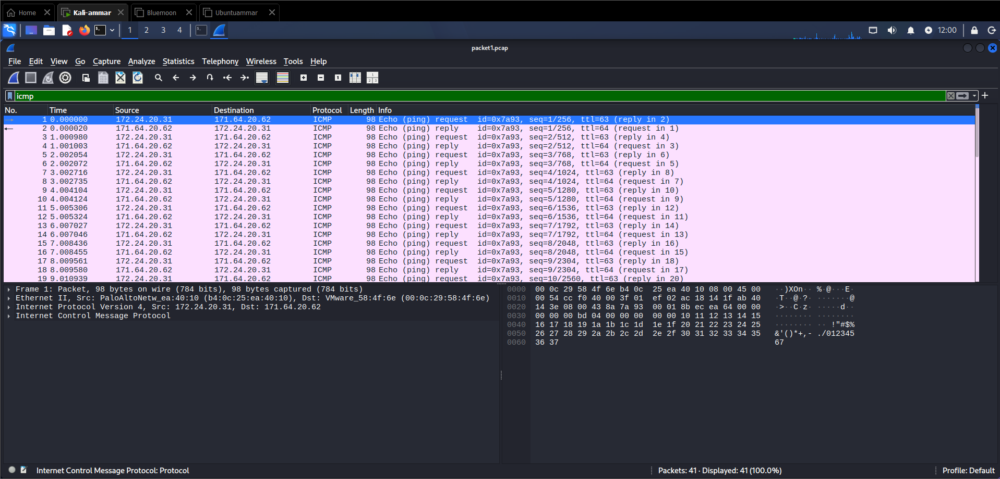

All the normal pings are 98 bytes long and carry the usual Linux padding (`!"#$%&'()*+,-./01234567`). So I looked for the odd one out. **Frame 37** stands out immediately — it is only 70 bytes, has a different ICMP identifier (`id=0x0001` instead of `0x7a93`), and instead of the standard padding its 28-byte data field holds readable Base64.

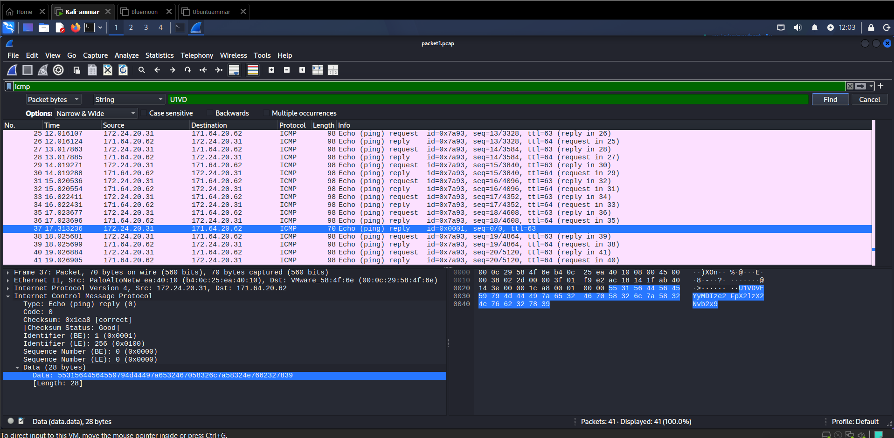

Reading the Data field as text gives `U1VDVEYyMDIze2FpX2lzX2Nvb2x9`, which is Base64 (letters, numbers, ends in `=` style length). I decoded it in the terminal:

```bash
echo 'U1VDVEYyMDIze2FpX2lzX2Nvb2x9' | base64 -d
```

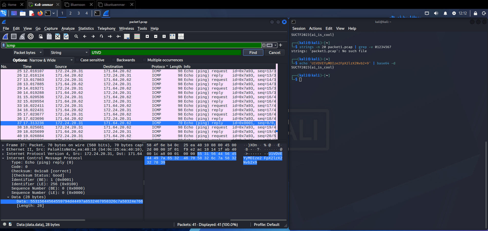

### Answer

```
Flag: SUCTF2023{ai_is_cool}
```

The technique here is **data exfiltration hidden inside an ICMP payload** (ICMP tunnelling) — the attacker buries one crafted ping among normal ones so it blends into the traffic.

---

## Question 2 — Analyse `packet2.pcap` and find the flag

### Method

This capture is bigger (794 packets). Most of it is 668 ICMP pings, but those are just noise to pad the capture out. Filtering with `tcp` shows what actually matters. There are a few short TCP "chats" on odd ports (4444, 8888, 9999…) that spell out dialogue from the movie *WarGames* — those are a distraction.

The real payload is an **FTP session**:

- Anonymous login with a blank password
- `RETR global_thermonuclear_war.gamerules.txt`

I followed the FTP-DATA stream (Follow → TCP Stream). The downloaded file contains a single line — a shortened link `https://tinyurl.com/yr5zprz4`. Opening it redirects to a Google Doc titled **"Club Tux"**.

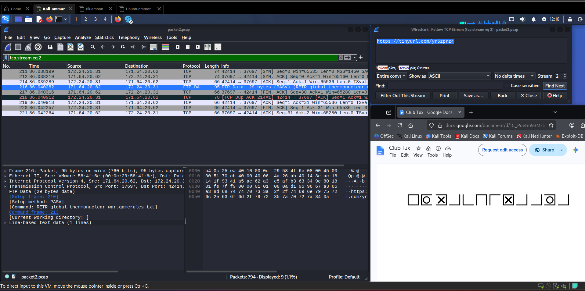

The Google Doc displays the text in a Wingdings-style symbol font, but the underlying document is a list of `char()` codes:

```
char(69) char(88) char(77) char(65) char(67) char(72) char(73) char(78) char(65) char(65) char(86) char(65)
```

Converting those decimal values to ASCII (69=E, 88=X, 77=M …) spells it out.

### Answer

```
Flag: EXMACHINAAVA   (i.e. "Ex Machina, Ava")
```

This ties back to the AI theme of Question 1. The chain was: **ICMP noise → FTP file → URL shortener → Google Doc → decode char() codes.**

> Note: depending on the required format, this may be submitted as `SUCTF2023{EXMACHINAAVA}` — confirm with the lecturer.

---

## Question 3 — Interpret an Nmap output

```
PORT     STATE SERVICE      VERSION
21/tcp   open  ftp          vsftpd 2.3.4
22/tcp   open  ssh          OpenSSH 5.3p1
80/tcp   open  http         Apache 2.2.8
139/tcp  open  netbios-ssn
445/tcp  open  microsoft-ds Windows 7 Professional 7601 Service Pack 1
```

### 1. What an attacker can do with each port

| Port | Service | What an attacker can do |
|------|---------|--------------------------|
| 21 | vsftpd 2.3.4 | Log in / pull files, and trigger the known backdoor |
| 22 | OpenSSH 5.3p1 | Brute-force credentials, enumerate valid usernames |
| 80 | Apache 2.2.8 | Map the web app, run directory & vuln scanners, look for web flaws |
| 139 | NetBIOS-ssn | Enumerate shares, users, null sessions (`enum4linux`) |
| 445 | microsoft-ds (Win7 SP1) | SMB attacks — the big one, remote code execution |

### 2. Likely vulnerabilities based on version

- **vsftpd 2.3.4** → famous backdoor **CVE-2011-2523**. A username ending in `:)` opens a root shell on port 6200.
- **OpenSSH 5.3p1** → outdated; username enumeration (CVE-2018-15473), weak to brute force.
- **Apache 2.2.8** → end-of-life; Range-header DoS "Apache Killer" (CVE-2011-3192) and other 2.2.x issues.
- **NetBIOS 139** → information disclosure via SMB enumeration.
- **Windows 7 SP1 / SMB 445** → **MS17-010 "EternalBlue" (CVE-2017-0144)** — unauthenticated remote code execution as SYSTEM.

### 3. Highest risk and why

**Port 445 (MS17-010 / EternalBlue)** is the highest risk. It needs no credentials, gives full SYSTEM-level access, is wormable (this is what WannaCry used to spread), and has a ready-made Metasploit module. The vsftpd 2.3.4 backdoor is a close second because it hands over a root shell just as easily.

### 4. Attack path that can be built from this

1. Confirm the flaw: `nmap -p445 --script smb-vuln-ms17-010 <target>`
2. Exploit: `exploit/windows/smb/ms17_010_eternalblue` in Metasploit
3. Get a SYSTEM shell
4. Dump credentials (`hashdump` / mimikatz)
5. Pass-the-hash / pivot to other machines on the network

Alternative route: `exploit/unix/ftp/vsftpd_234_backdoor` → instant root shell.

### 5. Remediation

- Patch **MS17-010**, or better, migrate off Windows 7 (end-of-life, no more security updates).
- **Disable SMBv1** and block ports 139/445 at the perimeter firewall.
- Upgrade **vsftpd, OpenSSH, and Apache** to current supported versions.
- **Disable anonymous FTP.**
- Enforce SSH key authentication and deploy `fail2ban` against brute force.

> Observation: a single host can't realistically run Linux services (21/22) *and* be Windows 7 (445) at the same time, so this is best treated as a sample/combined port list for the exercise.

---

## Question 4 — OS fingerprinting from TTL

Different operating systems set a different **default initial TTL**, so the TTL value in a ping reply is a quick way to guess the OS.

| Default TTL | Operating System |
|-------------|------------------|
| 64 | Linux / Unix |
| 128 | Windows |
| 255 | Network device (Cisco router / *nix appliance) |

**Image 1 — TTL = 64 → Linux.** The ping replies show `ttl=64`, and the host is confirmed as Fedora 34.

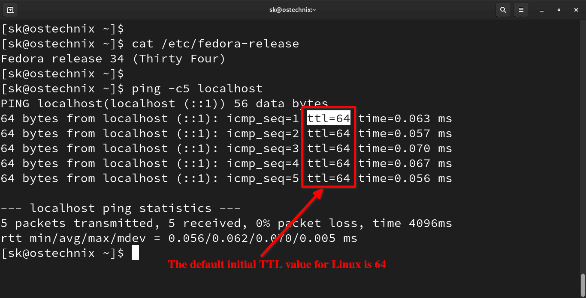

**Image 2 — TTL = 255 → Network device (router).** The device is sending ICMP "Time-to-live exceeded" messages with an IP TTL of 255. (The `TTL = 1` shown *inside* the quoted packet is just the traceroute probe that expired — it is not the OS fingerprint.)

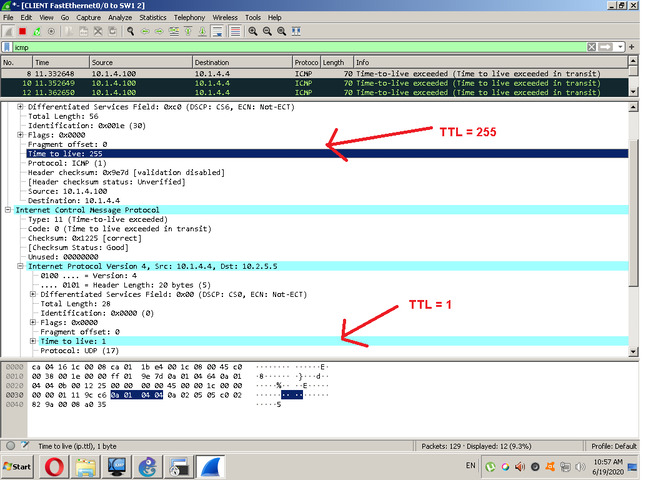

**Image 3 — TTL = 128 → Windows.** The replies show `ttl=128`, the Windows default.

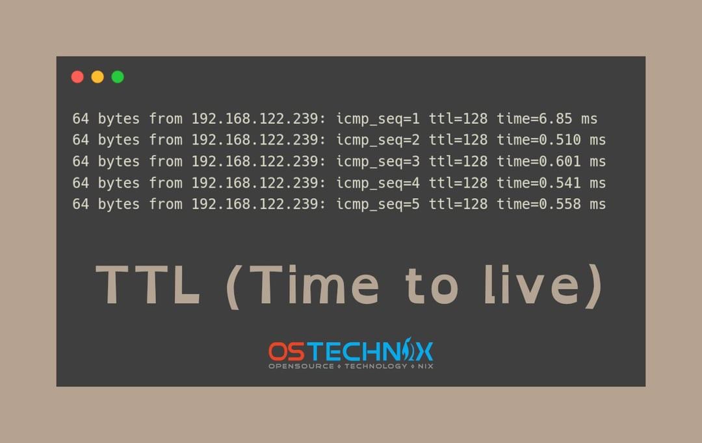

---

## Question 5 — Analyse the Nessus file (Ghostcat)

I imported `Network_Scan.nessus` into Nessus Essentials. The scan has one host, `192.168.232.139` (Ubuntu 8.04 / Metasploitable 2), with multiple critical and high findings. Auth shows **Fail** (unauthenticated scan), so these are all remote findings.

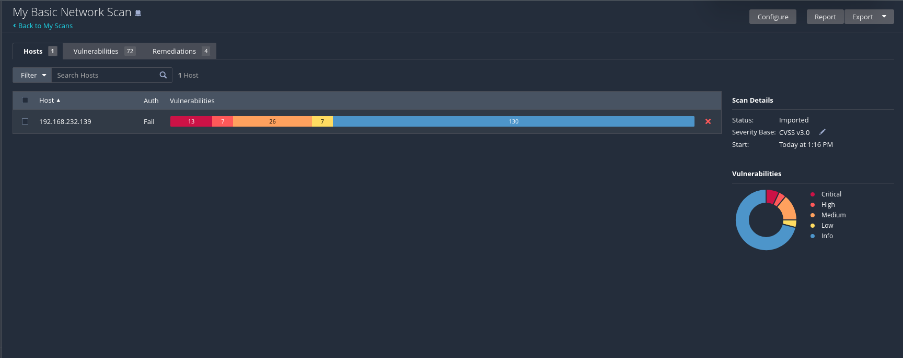

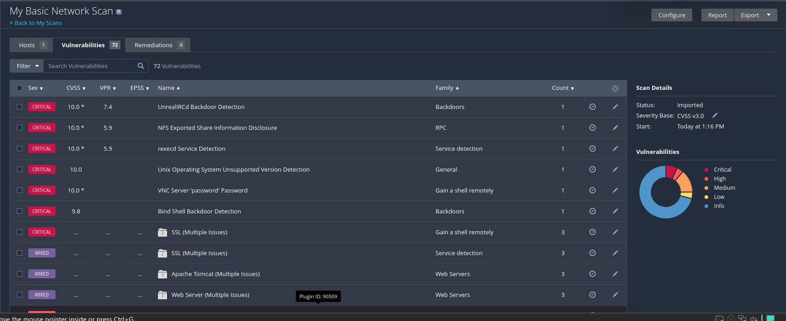

The **Remediations** tab lists Ghostcat directly:

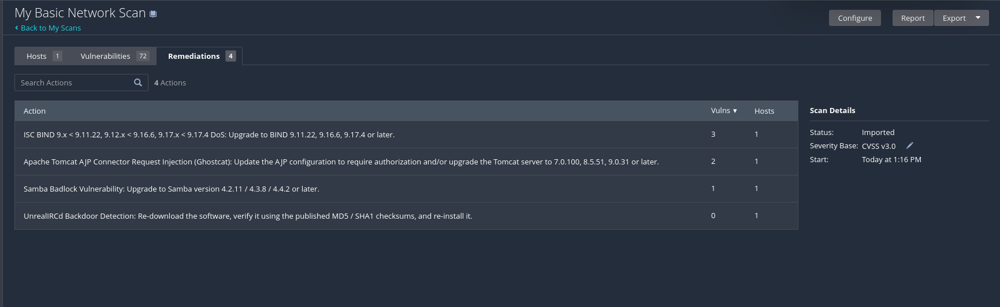

Opening the Ghostcat plugin (ID **134862**) gives the full detail — description, solution, CVE, VPR, and the proof that Nessus exploited it:

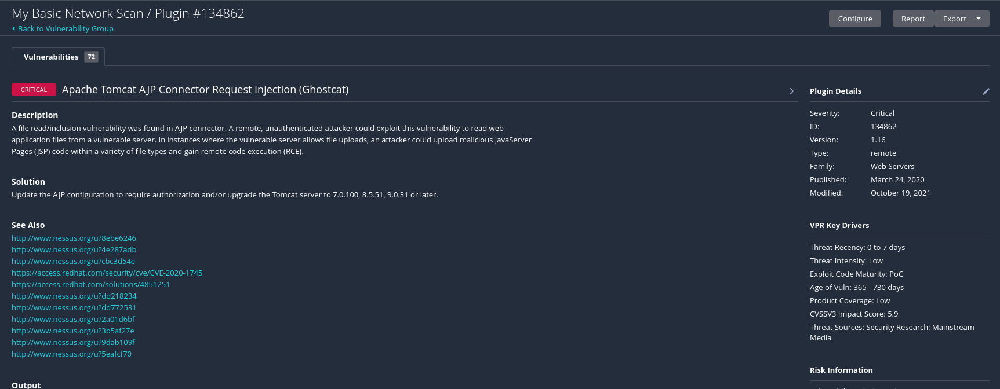

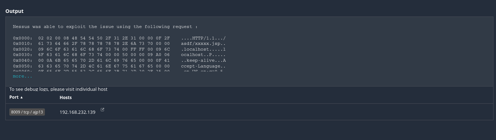

### Answers

**1. Affected port number:** `8009` (shown in the Output panel as `8009 / tcp / ajp13`)

**2. Affected protocol:** **AJP13** — the Apache JServ Protocol connector, running over TCP.

**3. CVSS score:** **CVSS v3 base = 9.8 (Critical)**. Supporting values: CVSSv3 Impact Score 5.9, CVSS v2 base 7.5, VPR 9.6.

**4. Exploit available?** **Yes.** Nessus marks Exploit Code Maturity = **PoC** and actually exploited it during the scan (see the raw AJP request in the Output panel). Public exploits:
- Metasploit: `auxiliary/admin/http/tomcat_ghostcat`
- Exploit-DB: **48143** (`searchsploit ghostcat`)

**5. CVE:** **CVE-2020-1938** (primary), with related **CVE-2020-1745**.

### Why it matters

Ghostcat is a file read / inclusion flaw in the AJP connector. A remote, unauthenticated attacker can read web application files (e.g. `WEB-INF/web.xml`), and if the server also allows file uploads, it escalates to **remote code execution** via a malicious JSP.

**Fix:** upgrade Tomcat to 7.0.100 / 8.5.51 / 9.0.31 or later, and if the AJP connector isn't needed, disable it or bind it to localhost and require a `secret`.

---

## Summary of flags

| Task | Flag |
|------|------|
| packet1.pcap | `SUCTF2023{ai_is_cool}` |
| packet2.pcap | `EXMACHINAAVA` |
